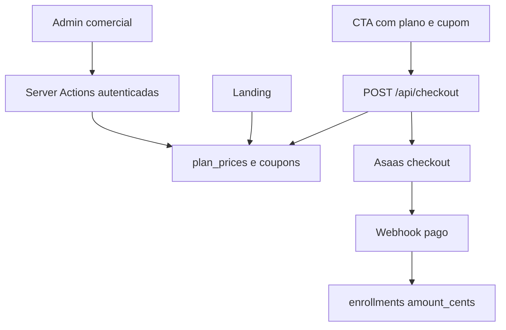

# Pricing and Coupons Design

**Spec**: `.specs/features/pricing-coupons/spec.md`
**Status**: Approved

## Architecture Overview

O catálogo continua responsável por copy, entregas e slugs estáveis. Preços deixam o catálogo e passam a ser carregados do banco. O admin grava preços e cupons por Server Actions autenticadas. O checkout resolve preço e cupom no servidor, reserva o uso com um `UPDATE` condicional, cria o checkout Asaas e desfaz a reserva se a criação falhar.



## Code Reuse Analysis

### Existing Components to Leverage

| Component | Location | How to Use |
| --- | --- | --- |
| Plano e slugs | `content/plans.ts` | Mantém nomes, copy e slugs; remove preço do contrato exibido. |
| Checkout Asaas | `lib/asaas.ts` | Recebe o valor calculado em vez de buscar preço estático. |
| Sessão do admin | `lib/admin-session.ts` | Valida sessão em ações comerciais. |
| Tema admin | `app/admin/(dashboard)/layout.tsx` | Recebe a nova rota comercial na navegação. |
| Padrão Drizzle | `lib/enrollments.ts` | Define repositórios testáveis por injeção de `Db`. |

### Integration Points

| System | Integration Method |
| --- | --- |
| PostgreSQL | Migration cria preços e cupons; Drizzle define as tabelas. |
| Landing | Server Component carrega preços por slug e força renderização dinâmica. |
| Asaas | Payload recebe preço final positivo calculado no servidor. |
| Webhook | Valor recebido no item do checkout é persistido como valor pago. |

## Components

### Commercial repository

- **Purpose**: Ler e atualizar preços; criar, listar, desativar e reservar cupons.
- **Location**: `lib/commercial.ts`
- **Interfaces**:
  - `listPlanPrices(db?): Promise<Record<PlanSlug, number>>`
  - `updatePlanPrice(input, db?): Promise<void>`
  - `createCoupon(input, db?): Promise<Coupon>`
  - `deactivateCoupon(id, db?): Promise<void>`
  - `reserveCoupon(code, plan, priceCents, now, db?): Promise<CheckoutPrice>`
  - `releaseCouponReservation(couponId, db?): Promise<void>`
- **Dependencies**: `lib/db.ts`, `lib/schema.ts`, `content/plans.ts`.
- **Reuses**: Repositório Drizzle injetável de `lib/enrollments.ts`.

### Commercial admin actions and page

- **Purpose**: Mostrar e atualizar preços, criar cupons e desativar cupons.
- **Location**: `app/admin/(dashboard)/comercial/`
- **Interfaces**: Server Actions recebem `FormData`, validam a sessão e revalidam `/` e `/admin/comercial` após mutação.
- **Dependencies**: `lib/commercial.ts`, sessão admin.
- **Reuses**: Layout e tokens do admin.

### Checkout pricing integration

- **Purpose**: Validar o plano e cupom, reservar uso e enviar o valor final ao Asaas.
- **Location**: `app/api/checkout/route.ts`, `lib/asaas.ts`.
- **Interfaces**: `POST { plan, couponCode? }`.
- **Dependencies**: Repositório comercial e Asaas.
- **Reuses**: Tratamento atual de `AsaasApiError`.

### Landing plan comparison

- **Purpose**: Mostrar preços persistidos e recolher opcionalmente o código do cupom antes do checkout.
- **Location**: `app/page.tsx`, `components/PlanComparison.tsx`.
- **Interfaces**: recebe planos enriquecidos com preço formatado.
- **Dependencies**: Repositório comercial.
- **Reuses**: Copy e cards existentes.

## Data Models

### plan_prices

```typescript
interface PlanPrice {
  plan: PlanSlug
  priceCents: number
  updatedAt: Date
}
```

Um registro por slug de plano. A migration inicial usa os valores comerciais atuais.

### coupons

```typescript
interface Coupon {
  id: string
  code: string
  discountType: "percentage" | "fixed"
  discountValue: number
  plan: PlanSlug | null
  expiresAt: Date | null
  maxUses: number | null
  reservedUses: number
  active: boolean
  createdAt: Date
  updatedAt: Date
}
```

`reservedUses` é incrementado de forma condicional no momento em que o checkout é criado. O contador representa usos reservados, inclusive checkouts ainda não pagos.

## Error Handling Strategy

| Error Scenario | Handling | User Impact |
| --- | --- | --- |
| Preço ausente | Checkout retorna 400 e não chama Asaas. | Mensagem para tentar novamente. |
| Cupom inválido | Checkout retorna 400 com mensagem específica. | Corrige ou remove o código. |
| Limite concorrente | `UPDATE ... WHERE reserved_uses < max_uses` não retorna linha. | Mesmo erro de cupom esgotado; sem cobrança excedente. |
| Falha Asaas após reserva | Repositório reduz `reservedUses`. | Cupom permanece disponível. |
| Formulário admin inválido | Ação retorna erro de campo e não grava. | Admin corrige o dado. |

## Risks & Concerns

| Concern | Location | Impact | Mitigation |
| --- | --- | --- | --- |
| `process-checkout-event` grava o preço estático do catálogo | `lib/process-checkout-event.ts:125-129` | Uma compra com cupom registraria valor incorreto. | Persistir o valor do item confirmado pelo webhook. |
| Reservas de checkouts abandonados contam como uso | `coupons.reserved_uses` | Cupom limitado pode esgotar antes de todos os pagamentos. | Regra assumida e exibida no admin como “usos reservados”; expiração de reservas fica fora de escopo. |
| Landing passa a depender de banco | `app/page.tsx` | Falha de banco impede renderizar preço atual. | Tornar a rota dinâmica; não usar fallback que possa divergir do checkout. |

## Tech Decisions

| Decision | Choice | Rationale |
| --- | --- | --- |
| Fonte de preço | Banco por slug, não variável de ambiente | Admin precisa alterar sem deploy. |
| Aplicação de cupom | Servidor antes do Asaas | Cliente não pode manipular valor. |
| Controle de limite | Reserva atômica ao criar checkout | Evita exceder máximo sob concorrência. |
| Autorização admin | Server Actions validam cookie assinado | Uma rota de UI protegida não basta para proteger mutações. |
