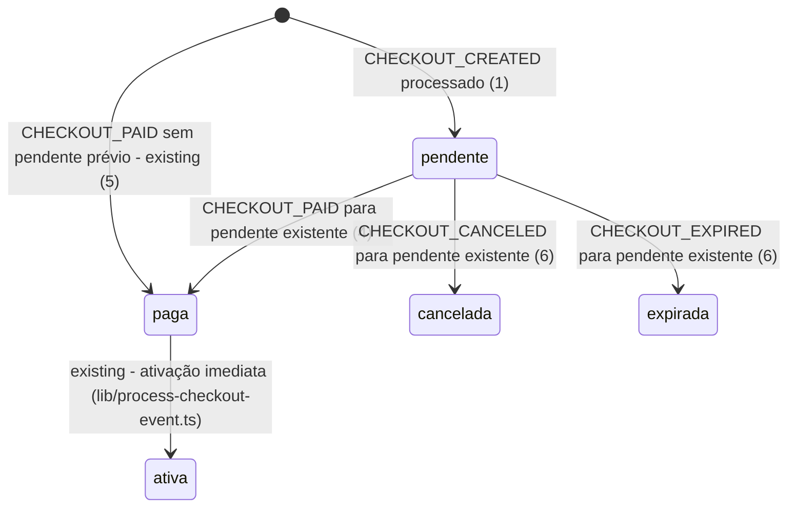

# Checkouts abandonados

> Build this with **tlc-implement** (`.claude/skills/tlc-implement`).
> Every criterion below becomes a check with a proof, referenced by its number. Nothing under
> `Unresolved` gets settled while building.

## Intent

Hoje, quando alguém inicia um checkout e não conclui o pagamento, o Asaas manda o evento
`CHECKOUT_CREATED` mas `processCheckoutEvent` ignora qualquer evento que não seja
`CHECKOUT_PAID`/`CHECKOUT_CANCELED`/`CHECKOUT_EXPIRED` - nenhum registro fica da tentativa, e o
mentor não tem como saber quem chegou a iniciar um checkout e desistiu, perdendo a chance de um
contato ativo pra recuperar a venda.

`CHECKOUT_CREATED` passa a criar uma inscrição com status `pendente` (já previsto na máquina de
estados de `lib/enrollment-state.ts`, nunca usado até hoje). Uma aba/filtro "Abandonados" no
painel de inscrições mostra essas inscrições pendentes com o tempo decorrido desde o início, e
permite marcar cada uma para contato ou ignorá-la.

11 criteria in 2 slices · 1 one-way door · 1 open, of which 0 block

## Criteria

### Capturar o checkout iniciado

1. Given a `CHECKOUT_CREATED` event whose `externalReference` matches a known plan slug, when
   it's processed, then an enrollment is created with status `pendente`, the matching plan,
   `customerName`/`customerEmail` from `customerData` when present, `amountCents` from the
   plan's `priceCents`, and `paidAt`/`expiresAt` both null.
2. Given a `CHECKOUT_CREATED` event with no `externalReference` or an unrecognized plan slug,
   when it's processed, then no enrollment is created and the mentor is alerted the same way an
   invalid `CHECKOUT_PAID` is alerted today (`sendMentorRejectedCheckoutAlert`).
3. Given a `pendente` enrollment already exists for a checkout id, when a second
   `CHECKOUT_CREATED` arrives for that same checkout id, then no duplicate row is created.
4. Given a `pendente` enrollment exists for a checkout id, when `CHECKOUT_PAID` arrives for that
   same checkout id, then that existing row transitions `pendente -> paga -> ativa` (both already
   valid in `lib/enrollment-state.ts`) - no new row is inserted.
5. Given no enrollment exists yet for a checkout id (no `CHECKOUT_CREATED` was ever processed for
   it), when `CHECKOUT_PAID` arrives, then today's existing insert behaviour is unchanged.
6. Given a `pendente` enrollment exists for a checkout id, when `CHECKOUT_CANCELED` or
   `CHECKOUT_EXPIRED` arrives for that same checkout id, then the row transitions to `cancelada`
   or `expirada` respectively (both already valid in `lib/enrollment-state.ts`).

### Ver e agir sobre os abandonados

7. On `/admin/inscricoes`, when the admin selects the "Abandonados" filter/tab, the table shows
   only enrollments with status `pendente`, sorted by `createdAt` ascending (oldest first), with
   an elapsed-time column computed from `createdAt` (e.g. "12min", "3h", "2d").
8. When no `pendente` enrollment exists, the Abandonados view shows "Nenhum checkout abandonado
   no momento." instead of an empty table.
9. Each row in the Abandonados view shows two actions: "Marcar para contato" and "Ignorar".
10. When the admin clicks "Marcar para contato" on a row, `pendente_action` for that enrollment
    is set to `contatado` and the row shows that tag from then on.
11. When the admin clicks "Ignorar" on a row, `pendente_action` is set to `ignorado` and that
    enrollment is excluded from the Abandonados view from then on, while remaining visible in the
    main list (`painel-inscricoes.md`) with status Pendente.

## States

## Out of scope

- Desfazer "Ignorar" - não pedido; editável direto no banco se necessário por enquanto.
- E-mail/alerta automático quando um checkout é só iniciado (`pendente`) - não pedido pelas user
  stories; a própria aba Abandonados já é a forma de visibilidade pedida.
- Definir um limite de tempo pra considerar algo "abandonado" (ex. só depois de 1h) - ver
  Unresolved #1.

## Observable

| Surface | Decision | Landing |
| --- | --- | --- |
| screen `/admin/inscricoes` (aba Abandonados) | empty state | 8 |
| screen `/admin/inscricoes` (aba Abandonados) | destructive action confirms | n/a - "Ignorar" só oculta a linha dessa visão (critério 11), não apaga dado nenhum; ferramenta de admin único, sem necessidade de confirmação |
| screen `/admin/inscricoes` (aba Abandonados) | unauthorised | existing - mesma tela protegida por `middleware.ts` (ver `painel-inscricoes.md`) |
| webhook `POST /api/webhooks/asaas` (rota existente, agora também recebe `CHECKOUT_CREATED`) | response shape e error codes | existing - o tratamento de erro já existente da rota (try/catch + `logOutcome`) cobre o novo tipo de evento sem branch nova |

## Swept

- validation: 2
- failure modes: existing - o try/catch + `logOutcome("error", ...)` já existente em `app/api/webhooks/asaas/route.ts` cobre falhas no processamento de `CHECKOUT_CREATED` do mesmo jeito que já cobre `CHECKOUT_PAID`
- idempotency and retry: 3 (sem duplicar linha por checkout) + existing (dedupe por `event.id` via PK de `webhook_events`, já cobre reenvio do mesmo evento)
- authorization: existing - `middleware.ts` já cobre esta mesma tela (`/admin/inscricoes/:path*`)
- concurrency and ordering: 4, 5 (`CHECKOUT_PAID` chegando antes ou depois de `CHECKOUT_CREATED` pro mesmo checkout)
- data lifecycle: n/a - linhas `pendente`/`contatado`/`ignorado` não são apagadas nem arquivadas; nenhuma política de retenção foi pedida
- external-dependency failure: existing - mesma razão de failure modes; esta task só recebe webhook, não chama o Asaas
- state transitions: 1, 4, 6 (ver States acima)
- observability: existing - a própria aba Abandonados (7) é a visibilidade pedida; nenhum log/métrica adicional foi pedido

## Impact

| Front | What changes |
|---|---|
| domain | existing term: "uma inscrição só existe depois do pagamento confirmado" deixa de valer - uma inscrição agora pode existir em `pendente`, antes de qualquer pagamento. Quem depende disso hoje: `findActiveByEmailAndPlan` (filtra `status = "ativa"` explicitamente - seguro), `markExpiredEnrollments` (só transiciona a partir de `ativa` via `canTransition` - seguro). Revisado, nenhum caller quebra. |
| domain | existing term: `processCheckoutPaid` "sempre insere uma inscrição nova" passa a significar "insere OU atualiza, dependendo de já existir uma linha `pendente` pro mesmo checkout" - vive em `lib/process-checkout-event.ts` |
| domain | new term: `pendente_action` - se o mentor marcou uma inscrição `pendente` para contato ou optou por ignorá-la; vive na tabela `enrollments` (`lib/schema.ts`) |
| stored data | coluna nova, nullable - hoje a tabela não tem nenhuma linha `pendente` na prática (nunca foi escrita antes desta task), então não há backfill a fazer |

## Decided

| Decision | Shape | Alternative rejected |
|---|---|---|
| Adicionar `enrollments.pendente_action` | coluna nova em `lib/schema.ts`, `text`, nullable, valores `'contatado' \| 'ignorado'`, default null | Tabela separada de notas de admin - rejeitada por generalizar além do pedido (só 2 ações fixas, não anotação livre) |

## Sources

- US-04 (mensagem do usuário que originou esta task) - escopo da aba, do tempo decorrido e das 2 ações
- `lib/enrollment-state.ts` - `VALID_TRANSITIONS` já definia `pendente->paga`, `pendente->cancelada` e `pendente->expirada` antes desta task, nunca exercitadas
- [Eventos para Checkout](https://docs.asaas.com/docs/checkout-events) - confirma `CHECKOUT_CREATED` como evento real de checkout, com os mesmos campos (`externalReference`, `customerData`) já usados para `CHECKOUT_PAID`
- `.specs/features/landing-mentoria/design.md` ("Asaas Webhook", "Data Models") - já listava `CHECKOUT_CREATED` entre os eventos recebidos, nunca implementado

## Unresolved

| # | Kind | Question | Until answered |
|---|---|---|---|
| 1 | open | Existe um limite de tempo pra considerar um checkout "abandonado" (ex. só depois de 1h sem pagar), ou a aba deve mostrar todo `pendente` independentemente da idade e deixar o julgamento com o admin? | Critério 7 foi escrito sem corte por idade - mostra todos, ordenados do mais antigo pro mais recente. |
